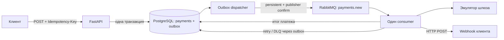
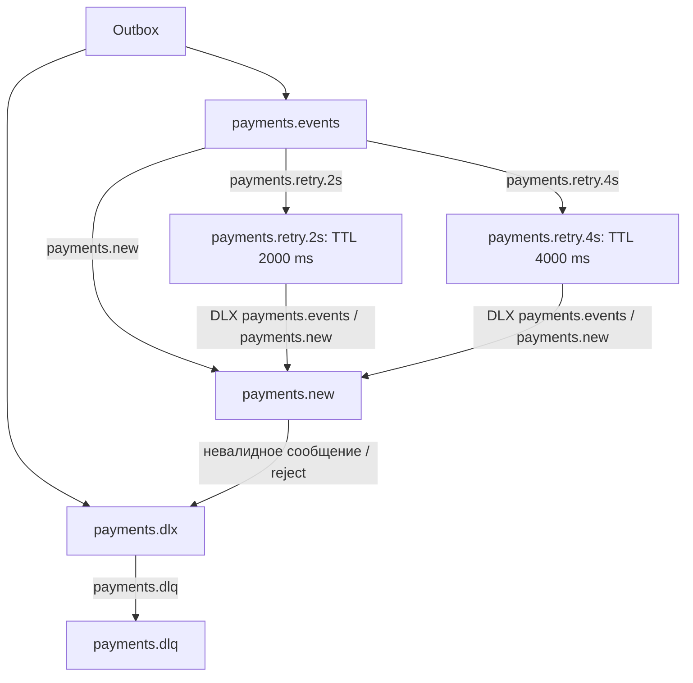

# Асинхронный процессинг платежей

Сервис принимает платёж через HTTP, атомарно сохраняет платёж и событие в PostgreSQL, обрабатывает его через RabbitMQ и отправляет результат на webhook. Платёжный шлюз эмулируется: задержка 2–5 секунд, вероятность успеха 90%, бизнес-отказа 10%.

Стек: Python 3.12, FastAPI, Pydantic v2 / pydantic-settings, SQLAlchemy 2 Async / asyncpg, PostgreSQL 17, FastStream / RabbitMQ 4.1, Alembic, HTTPX, Docker Compose. Проверенные версии Python-зависимостей зафиксированы в `requirements.lock`; Docker использует этот файл как constraints.

## Быстрый запуск

Нужны Docker Engine / Docker Desktop и Docker Compose v2.

```bash
git clone https://github.com/Cyper222/payment-processing.git
cd payment-processing
cp .env.example .env
```

В `.env` задайте собственные `API_KEY`, `POSTGRES_PASSWORD`, `RABBITMQ_PASSWORD`. Для каждого секрета можно получить отдельное случайное значение:

```bash
openssl rand -hex 32
```

Используйте буквенно-цифровые / hex пароли: Compose подставляет их в URL подключения. API-ключ должен содержать не менее 16 символов.

```bash
docker compose up --build -d
docker compose ps
docker compose logs -f api consumer
```

PostgreSQL и RabbitMQ проходят healthcheck. Одноразовый контейнер `migrate` выполняет `alembic upgrade head`; API и consumer запускаются после успешной миграции. Consumer также ждёт готовности RabbitMQ. Повторный запуск использует существующие данные и миграции.

API доступен на `http://127.0.0.1:8000`. PostgreSQL и AMQP-порт доступны только внутри Compose-сети. Порты API, Management UI и демонстрационного webhook привязаны к loopback. Контейнеры приложения работают от непривилегированного пользователя, с файловой системой только для чтения и временным `/tmp`.

Для следующих примеров экспортируйте API-ключ из `.env`:

```bash
export API_KEY='значение-API_KEY-из-.env'
curl -fsS http://127.0.0.1:8000/health -H "X-API-Key: $API_KEY"
```

API, health, Swagger `/docs` и `/openapi.json` защищены `X-API-Key`. Схема OpenAPI описывает API-ключ и обязательный `Idempotency-Key`. Для открытия Swagger в браузере нужен клиент, добавляющий заголовок к запросам страницы и OpenAPI. Саму схему можно получить так:

```bash
curl -fsS http://127.0.0.1:8000/openapi.json -H "X-API-Key: $API_KEY"
```

## Демонстрация webhook и retry

Профиль `demo` добавляет локальный приёмник с просмотром запросов. Явное разрешение hostname позволяет использовать его приватный адрес в Docker-сети:

```bash
WEBHOOK_ALLOWED_HOSTS='["webhook-receiver"]' \
  docker compose --profile demo up --build -d
```

Для постоянного использования demo можно записать `WEBHOOK_ALLOWED_HOSTS=["webhook-receiver"]` в `.env`; тогда разрешение сохранится при последующих запусках без префикса команды.

Создать платёж:

```bash
curl -i http://127.0.0.1:8000/api/v1/payments \
  -H "X-API-Key: $API_KEY" \
  -H 'Idempotency-Key: order-1001' \
  -H 'Content-Type: application/json' \
  -d '{
    "amount": "1250.50",
    "currency": "RUB",
    "description": "Заказ 1001",
    "metadata": {"order_id": "1001"},
    "webhook_url": "http://webhook-receiver:8080/events"
  }'
```

Ответ `202 Accepted`:

```json
{
  "payment_id": "a46d403b-c246-42cc-a713-1083de10a942",
  "status": "pending",
  "created_at": "2026-10-14T12:00:00Z"
}
```

Подставьте реальный `payment_id` из ответа:

```bash
export PAYMENT_ID='a46d403b-c246-42cc-a713-1083de10a942'
curl -fsS "http://127.0.0.1:8000/api/v1/payments/$PAYMENT_ID" \
  -H "X-API-Key: $API_KEY"
curl -fsS http://127.0.0.1:8081/events
```

GET возвращает все поля платежа и технические поля доставки: `webhook_delivered_at`, `completed_attempt`, `last_error`, `processing_event_id`. Сумма передаётся десятичной строкой. Статус платежа может стать окончательным раньше, чем будет доставлен webhook; доставку подтверждает `webhook_delivered_at`.

Для демонстрации повторов создайте **новый** платёж с новым `Idempotency-Key` и URL `http://webhook-receiver:8080/events?fail_first=2`. Приёмник ответит `503` дважды, затем `200`. GET `/events` покажет три попытки. Для DLQ используйте `?fail_first=100`: после третьего сбоя сообщение окажется в `payments.dlq`.

Демонстрационный приёмник хранит последние 1000 запросов в памяти; после его перезапуска история и счётчики обнуляются. Это инструмент локальной проверки, без аутентификации. Он не предназначен для внешней публикации.

## Контракт API

| Операция / ситуация | Результат |
| --- | --- |
| `POST /api/v1/payments` | `202`, `payment_id`, текущий `status`, `created_at` |
| `GET /api/v1/payments/{payment_id}` | `200`, платёж целиком |
| Неизвестный UUID платежа | `404` |
| Нет / неверный `X-API-Key` | `401` |
| Невалидное тело, UUID, валюта, URL или нет `Idempotency-Key` | `422` |
| Тот же `Idempotency-Key`, другое содержимое запроса | `409` |
| Тот же `Idempotency-Key`, то же содержимое | `202`, существующий платёж |

Деньги хранятся как `NUMERIC(18, 2)` и обрабатываются как `Decimal`: положительная сумма, максимум 16 цифр в целой части и две в дробной. Значения с лишними знаками не округляются молча. Валюты: `RUB`, `USD`, `EUR`. `metadata` — JSON-объект до 16 KiB; ORM-атрибут `metadata_json` соответствует колонке `metadata`. Описание ограничено 1000 символами, URL — 2048, ключ идемпотентности — 200.

Идемпотентность обеспечивается уникальным индексом PostgreSQL, а не предварительной проверкой в памяти. Отпечаток нормализованного payload отличает повтор запроса от повторного использования ключа для другой оплаты. Конкурентные одинаковые запросы создают одну запись `payments` и одно начальное событие `outbox`. Область ключей глобальна для сервиса; ключи не истекают автоматически.

## Архитектура и транзакции



- `domain.py`: значения, статусы и доменные ошибки.
- `application/`: контракты хранилища, шлюза и webhook, оркестрация обработки.
- `infrastructure/`: ORM / транзакции, RabbitMQ, outbox dispatcher, HTTP webhook и эмулятор шлюза.
- `api/`, `main.py`: HTTP-валидация, аутентификация и адаптация результата use case.
- `worker.py`: один обработчик `payments.new` и фоновый dispatcher в одном процессе.

```text
src/payment_service/
  domain.py
  config.py
  main.py
  worker.py
  replay.py
  api/
  application/
  infrastructure/
alembic/                 # версионируемая схема; без create_all в приложении
tests/                   # unit и integration
scripts/webhook_receiver.py
Dockerfile
docker-compose.yml
compose.test.yml
requirements.lock
.env.example
```

При POST строки `payments` и `outbox` фиксируются в одной транзакции. Вызов брокера не участвует в HTTP-запросе: RabbitMQ может быть временно недоступен, а платёж и событие остаются в базе.

Dispatcher выбирает неопубликованные строки с `FOR UPDATE SKIP LOCKED`. Он отправляет persistent-сообщение в durable очередь с publisher confirms и отмечает `published_at` только после подтверждения. При ошибке / откате запись остаётся доступной для следующего прохода. `SKIP LOCKED` позволяет безопасно запускать несколько диспетчеров. Короткая транзакция публикации удерживает блокировку строки до bounded publisher confirm.

Сбой после подтверждения брокера, но до commit `published_at`, приводит к повторной публикации. Поэтому доставка — **at-least-once**. Отсутствие повторной бизнес-обработки обеспечивается consumer, а не обещанием exactly-once от брокера.

Consumer сериализует работу над одним платежом PostgreSQL advisory lock на отдельном соединении. Открытой транзакции PostgreSQL во время ожидания шлюза и webhook нет. Финальный статус и `processed_at` сохраняются до HTTP webhook. При повторной доставке терминального платежа шлюз больше не вызывается; если webhook уже подтверждён в БД, обработка завершается без HTTP-запроса. `completed_attempt` защищает от повторного исполнения уже завершённых попыток, `processing_event_id` отклоняет запоздавшие события предыдущего цикла после ручного replay.

Обычный `failed` от шлюза — бизнес-результат. Его webhook отправляется так же, как для `succeeded`; повторного списания из-за бизнес-отказа нет. Техническая ошибка до завершения шлюза может оставить статус `pending` и после попадания события в DLQ — это диагностируемая незавершённая обработка, а не подтверждённый отказ платежа.

## RabbitMQ, retry и DLQ

Все очереди durable quorum, сообщения persistent. Exchanges `payments.events` и `payments.dlx` имеют тип direct.



Всего **3 попытки**, включая начальную. После первой ошибки следующая попытка ждёт минимум 2 секунды, после второй — минимум 4 секунды. Это экспоненциальная задержка `2 ** attempt`; к ней добавляется время публикации, ожидания consumer и выполнения HTTP. Блокирующего `sleep` внутри обработчика для retry нет: задержку обеспечивает TTL очередей.

При ошибке consumer атомарно сохраняет номер завершённой попытки, краткую диагностическую ошибку и новое событие outbox для retry либо DLQ. Только затем подтверждает исходное сообщение. Поэтому падение между сохранением retry и ACK не теряет следующую попытку и не создаёт её повторно. Обработанные webhook-попытки не меняют уже окончательный статус платежа. Недоступность брокера при публикации outbox не расходует три попытки бизнес-обработчика.

После третьей технической ошибки событие публикуется через outbox в `payments.dlq`. Для TTL / DLX включена at-least-once dead-letter доставка quorum-очередей с `reject-publish` при переполнении.

При недоступности PostgreSQL записать transactional retry невозможно. Для этого случая обработчик публикует следующую попытку / DLQ непосредственно в RabbitMQ и делает ACK исходного сообщения **только после publisher confirm**. Если не удалась и публикация, выполняется NACK с requeue; quorum delivery limit `3` ограничивает такие аварийные redelivery и направляет сообщение через DLX в DLQ. В этом аварийном пути `completed_attempt` / `last_error` в базе могут отставать от сообщения DLQ. Невалидный JSON / формат события передаётся в DLQ с исходными байтами в base64, также с подтверждением перед ACK.

AMQP-событие содержит стабильный `event_id`, `payment_id`, `attempt` от 1 до 3 и необязательный безопасный текст `error`. Автоматические retry сохраняют `event_id`; outbox имеет уникальность `(event_id, attempt, destination)`.

Посмотреть состояние очередей:

```bash
docker compose exec rabbitmq rabbitmqctl list_queues \
  name type messages_ready messages_unacknowledged
```

RabbitMQ Management UI: [http://127.0.0.1:15672](http://127.0.0.1:15672). Логин и пароль — `RABBITMQ_USER` / `RABBITMQ_PASSWORD` из `.env`. В `Queues and Streams` видны основная очередь, retry-очереди и DLQ. Для просмотра DLQ через `Get messages` выбирайте **Requeue: Yes**, чтобы сохранить сообщение для диагностики.

После устранения причины сбоя повторную обработку создаёт операторская команда:

```bash
docker compose exec consumer python -m payment_service.replay "$PAYMENT_ID"
```

Команда работает через PostgreSQL: сохраняет финальный статус платежа, сбрасывает счётчик попыток и атомарно создаёт новое событие outbox с новым `event_id` / `processing_event_id`. Доставка затем идёт обычным dispatcher; старые события игнорируются. Команда отказывает, если webhook уже доставлен или остаются неопубликованные outbox-записи. Она не требует вручную публиковать JSON и не удаляет исходное диагностическое сообщение из DLQ. Повтор терминального платежа восстанавливает только доставку webhook.

Используйте replay после исправления причины и диагностики DLQ. Команда намеренно разрешает заменить цикл до трёх **записанных в БД** попыток: при недоступности PostgreSQL сообщение могло попасть в DLQ через аварийный путь, не обновив счётчик. Это явная операторская операция, а не автоматический обход лимита retry.

## Контракт webhook

Webhook отправляется методом POST с `Content-Type: application/json`. Успехом считается любой HTTP `2xx`; timeout, сетевые ошибки, `3xx`, `4xx` и `5xx` запускают предусмотренный retry. Redirect не выполняется. Таймаут охватывает DNS и HTTP; тело ответа не загружается в память.

Успех платежа:

```json
{
  "event": "payment.completed",
  "notification_id": "a46d403b-c246-42cc-a713-1083de10a942",
  "payment_id": "a46d403b-c246-42cc-a713-1083de10a942",
  "amount": "1250.50",
  "currency": "RUB",
  "status": "succeeded",
  "processed_at": "2026-10-14T12:00:03+00:00"
}
```

Бизнес-отказ:

```json
{
  "event": "payment.completed",
  "notification_id": "ba2a1820-796d-4da4-81ae-e19ed1b12ce6",
  "payment_id": "ba2a1820-796d-4da4-81ae-e19ed1b12ce6",
  "amount": "50.00",
  "currency": "EUR",
  "status": "failed",
  "processed_at": "2026-10-14T12:01:04+00:00"
}
```

`notification_id`, заголовки `X-Webhook-Id` и `Idempotency-Key` равны ID платежа и стабильны при retry и ручном replay. Получатель должен атомарно дедуплицировать уведомления по этому значению. Сбой после принятия webhook клиентом, но до фиксации `webhook_delivered_at` может привести к повторному HTTP-запросу.

Если задан `WEBHOOK_SIGNING_SECRET`, отправляется `X-Webhook-Signature: sha256=<hex>`, где `<hex>` — HMAC-SHA256 **исходных байтов HTTP-тела**. Проверяйте подпись до разбора JSON через constant-time comparison. Пустой секрет отключает подпись; для внешней интеграции задайте отдельный случайный секрет и используйте HTTPS.

## Конфигурация и безопасность

| Переменная | Назначение |
| --- | --- |
| `API_KEY` | Обязательный статический ключ, минимум 16 символов |
| `POSTGRES_USER`, `POSTGRES_PASSWORD`, `POSTGRES_DB` | Настройки PostgreSQL в Compose |
| `RABBITMQ_USER`, `RABBITMQ_PASSWORD` | Настройки RabbitMQ в Compose |
| `DATABASE_URL`, `RABBITMQ_URL` | Подключения приложения; Compose формирует из предыдущих значений |
| `WEBHOOK_ALLOWED_HOSTS` | JSON-массив явных исключений для приватных webhook-адресов, по умолчанию `[]` |
| `WEBHOOK_SIGNING_SECRET` | Опциональный секрет HMAC webhook |
| `WEBHOOK_TIMEOUT` | Общий timeout DNS + HTTP в секундах, по умолчанию `10`, максимум `30` |
| `OUTBOX_POLL_INTERVAL` | Пауза dispatcher при пустой очереди / ошибке, по умолчанию `0.5` секунды |
| `PUBLISH_TIMEOUT` | Timeout подтверждённой AMQP-публикации, по умолчанию `5` секунд |
| `LOG_LEVEL` | Уровень JSON-логов, по умолчанию `INFO` |
| `API_PORT` | Локальный порт API, по умолчанию `8000` |
| `RABBITMQ_MANAGEMENT_PORT` | Локальный порт Management UI, по умолчанию `15672` |
| `WEBHOOK_DEMO_PORT` | Локальный порт demo receiver, по умолчанию `8081` |

API-ключ сравнивается через безопасное сравнение и не записывается в логи. Webhook URL должен быть абсолютным HTTP(S)-адресом без credentials и fragment. По умолчанию запрещены loopback, private, link-local и другие непубличные IP. Перед каждым отправлением проверяются все DNS-ответы; HTTP-соединение закрепляется за проверенным IP с сохранением Host и TLS SNI. Proxy-переменные окружения не используются. Точное совпадение hostname с `WEBHOOK_ALLOWED_HOSTS` разрешает приватный адрес только для явным образом настроенного назначения.

Запрос сохраняет DNS-имя без синхронной DNS-проверки: недопустимое разрешение или недоступный hostname выявляются при доставке и отражаются в `last_error` / DLQ. В рабочих окружениях сетевые egress-правила служат дополнительной границей доступа к внутренней инфраструктуре.

JSON-логи показывают этап обработки, `payment_id`, `event_id`, `attempt` и безопасную причину ошибки. Полное содержимое платежей, URL webhook с параметрами, ключи и тела ответов webhook в логи не попадают.

## Миграции и управление окружением

```bash
docker compose run --rm migrate                  # alembic upgrade head
docker compose exec api alembic current
docker compose stop                             # корректная остановка
docker compose down                             # контейнеры и сеть; данные остаются
```

Данные находятся в именованных volumes `postgres-data` и `rabbitmq-data`. `docker compose down -v` удаляет их вместе с платежами и очередями. Миграция выполняется отдельным сервисом, а не одновременно всеми API-процессами.

Переменные начальных credentials PostgreSQL / RabbitMQ применяются при создании их хранилищ. Изменение пароля только в `.env` не меняет пароль уже существующего пользователя; для сохранённых volumes нужна штатная ротация пароля в соответствующем сервисе.

Worker отслеживает SIGTERM, прекращает приём сообщений и завершает текущую обработку. Compose даёт 45 секунд на остановку. API health проверяет БД; consumer health проверяет свежесть heartbeat, обновляемого при доступности БД / брокера и работоспособности фоновых задач. Запуск topology идемпотентен; изменение аргументов уже существующих очередей требует отдельной миграции RabbitMQ.

## Тесты и проверки

GitHub Actions запускает Ruff, проверку форматирования, строгий mypy и полный набор тестов с отдельными PostgreSQL / RabbitMQ при push в `main` и в pull requests. Workflow имеет только доступ на чтение содержимого репозитория и не использует рабочие секреты.

Быстрые тесты без инфраструктуры:

```bash
python3.12 -m venv .venv
. .venv/bin/activate
pip install -c requirements.lock '.[dev]'
pytest -q -m 'not integration'
ruff check .
ruff format --check .
mypy
```

Полный набор с отдельными PostgreSQL / RabbitMQ, без портов на хосте и без доступа к рабочим volumes:

```bash
docker compose -f compose.test.yml up --build \
  --abort-on-container-exit --exit-code-from tests
docker compose -f compose.test.yml down -v
```

Тестовый контейнер применяет настоящие Alembic-миграции и запускает pytest. Интеграционные тесты используют `INTEGRATION_DATABASE_URL` и `INTEGRATION_RABBITMQ_URL`. Без этих переменных соответствующие проверки пропускаются; для полного результата используйте приведённый Compose.

Тесты покрывают API / аутентификацию / валидацию, конкурентную идемпотентность, атомарность outbox, повторы публикации, бизнес-успех и отказ, повторные и конкурентные сообщения, восстановление после ошибок, webhook, retry и DLQ. Симулятор и HTTP-клиент имеют подменяемые зависимости: unit-тесты не ждут случайные 2–5 секунд и не зависят от вероятности успеха.

Проверка запущенного demo-окружения с реальными HTTP-запросами:

```bash
.venv/bin/python scripts/smoke.py
```

Скрипт читает ключи из `.env`, создаёт три тестовых платежа и проверяет аутентификацию, идемпотентность, webhook, ответы `503 → 503 → 200` и DLQ. Он сохраняет тестовые платежи и сообщение DLQ для последующего просмотра.

## Гарантии и ограничения

- Transactional outbox закрывает разрыв между сохранением платежа и публикацией события. Возможны дубли; потери подтверждённых событий при штатном восстановлении БД / брокера не ожидаются.
- Одна очередь и один обработчик выполняют весь сценарий; dispatcher встроен в consumer. Consumer можно масштабировать, а блокировка по платежу сериализует дубли. Скорость ограничена временем шлюза и webhook.
- Симулятор не выполняет внешнее списание. Для реального шлюза нужен устойчивый provider idempotency key, запрос состояния операции и reconciliation: падение между внешним списанием и записью результата нельзя решить одной локальной транзакцией.
- Quorum-очереди запущены на одном узле RabbitMQ: это устойчивость к перезапуску с сохранённым диском, без высокой доступности. Потеря volumes не покрывается outbox. Для production нужны backup PostgreSQL, несколько узлов RabbitMQ и политика восстановления.
- Статический API-ключ соответствует заданию; пользователей, ролей, tenant isolation и rate limiting нет. TLS обычно завершается на reverse proxy; вебхуки поддерживают HTTPS.
- Автоматические повторы ограничены тремя сохранёнными попытками. Падение процесса до фиксации попытки может вызвать redelivery; это ожидаемое поведение at-least-once. Доставка webhook требует идемпотентного получателя.
- Опубликованные outbox-записи и сообщения DLQ автоматически не удаляются. Для долгой эксплуатации нужна политика хранения и очистки после диагностики / архивирования.
- Сессионная advisory-блокировка требует прямого подключения PostgreSQL или session pooling; PgBouncer в transaction pooling для worker не подходит. После обработки соединение инвалидируется, чтобы блокировка гарантированно не попала обратно в пул; это добавляет стоимость переподключения.

Поведение подтверждений и dead-lettering соответствует официальным контрактам [RabbitMQ confirms](https://www.rabbitmq.com/docs/confirms) и [quorum queues](https://www.rabbitmq.com/docs/4.1/quorum-queues); ручное подтверждение использует [FastStream AckPolicy](https://faststream.ag2.ai/latest/getting-started/acknowledgement/).
